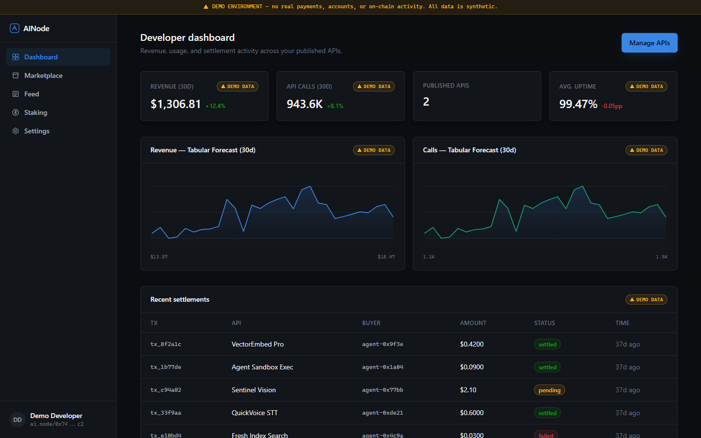
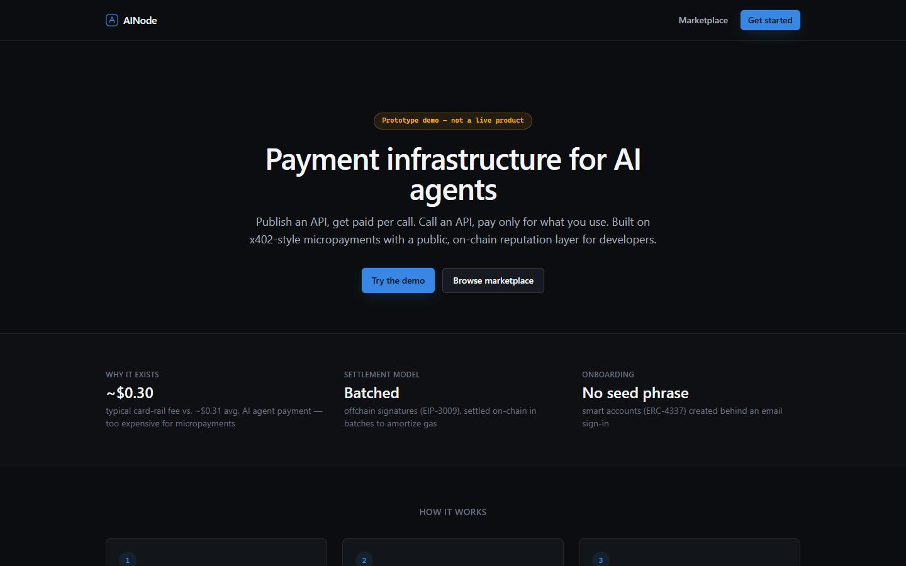
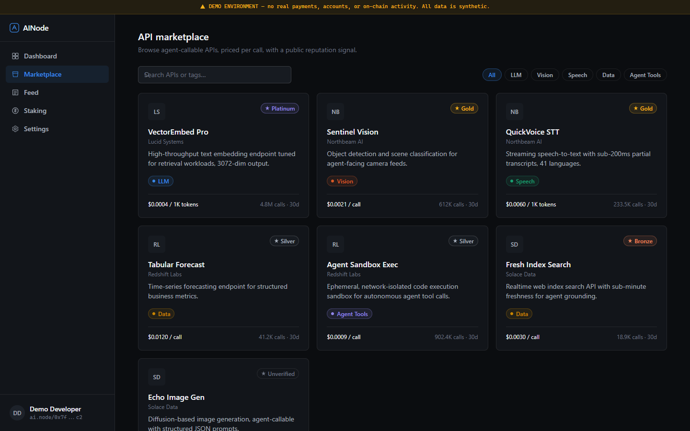
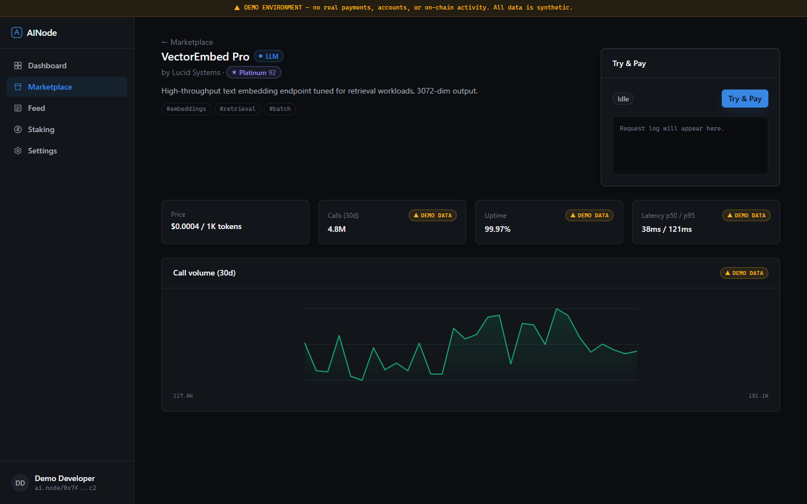
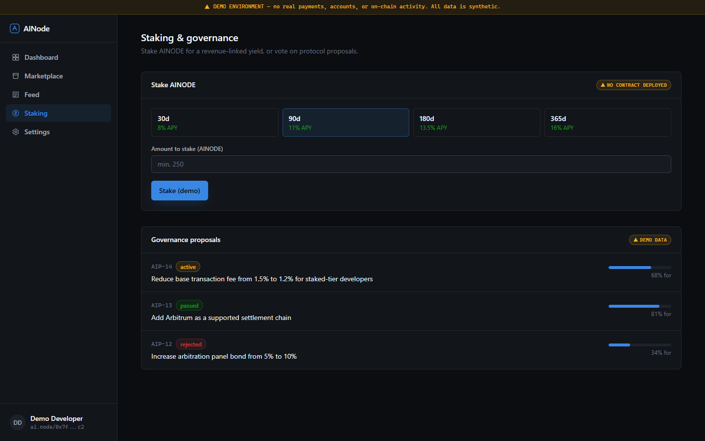
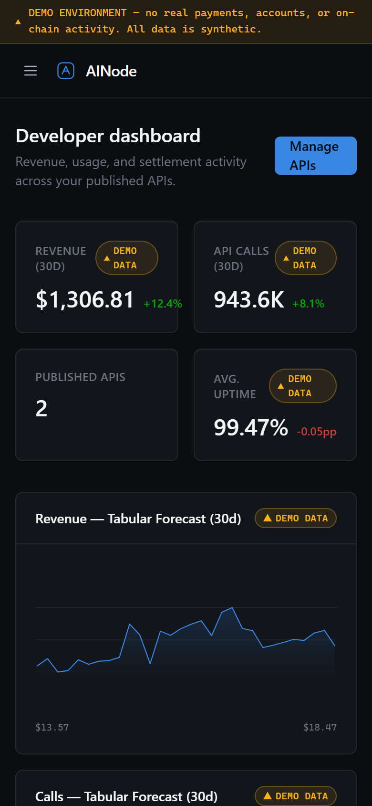

# AINode

**Payment infrastructure for AI agents — publish an API and get paid per call, or call an API and pay only for what you use.**

> **Status: Demo / Prototype.** This is a portfolio-grade frontend demo, not a live product. There is no backend, no deployed smart contract, no real payment processor, and no real user data anywhere in this repository. Every number, transaction, and account shown in the UI is synthetic and clearly labeled. See [`docs/DEMO.md`](docs/DEMO.md) for the full real-vs-simulated inventory.



## Problem
Traditional payment rails charge roughly $0.30 per transaction — uneconomical for AI-agent micropayments that average around $0.31. Existing infrastructure is either payments-only (x402, Nevermined) or reputation/content-only (Kaito, Cookie), with nothing unifying the two.

## Solution
AINode combines x402-style micropayments (agents pay per API call, settled in on-chain batches to amortize gas) with a public developer reputation layer and a social feed — all behind an "invisible wallet" onboarding flow (email sign-in, no seed phrase).

## Features (built in this demo)
- **Invisible-wallet onboarding** — email sign-in with a simulated ERC-4337 account creation flow.
- **Developer dashboard** — revenue/usage charts with hover tooltips, recent settlements table, API registration form.
- **API marketplace** — search, category filters, empty states, per-API detail pages.
- **"Try & Pay" simulation** — walks through the x402-style `402 → sign → settle` flow shape.
- **Social feed** — seeded posts, optimistic like interactions, reputation badges.
- **Staking & governance** — tiered APY selection, proposal list with vote-share bars.
- **Fully responsive** — desktop sidebar, mobile slide-in drawer navigation.

## Screenshots
| Landing page | API marketplace |
|---|---|
|  |  |
| **API detail with "Try & Pay"** | **Staking & governance** |
|  |  |

<p>
  
</p>

*Phone-sized screen (390 px wide).*

_Captured from the demo running locally. Every figure, account and transaction is synthetic — the persistent banner at the top of each screen says so. The UI is dark-mode only by design; see [`docs/DECISIONS.md`](docs/DECISIONS.md)._

## Architecture
A single Next.js 16 (App Router, React 19, TypeScript, Tailwind v4) frontend rendering from in-repo mock data — no backend, no database, no blockchain node. Full target-state architecture (what a real backend would look like, and exactly where it would plug in) is documented in [`docs/ARCHITECTURE.md`](docs/ARCHITECTURE.md).

## Tech stack
Next.js 16 · React 19 · TypeScript · Tailwind CSS v4 · hand-built SVG charts (no charting library) · system fonts (no external font loading).

## Demo instructions
```bash
cd web
npm install
npm run dev
```
Then open the printed local URL. Full walkthrough in [`docs/DEMO.md`](docs/DEMO.md).

## Installation / environment variables
No environment variables are required — the app runs entirely on in-repo mock data. See [`web/.env.example`](web/.env.example) for what a real backend integration would eventually need (none of it is wired up).

## Project structure
```
ainode/
├── web/                  Next.js app (the actual demo)
│   ├── app/               routes (landing, onboarding, dashboard, marketplace, feed, staking, settings)
│   ├── components/        UI primitives (badges, cards, charts, nav) + design system
│   └── lib/                mock data, formatters, category color map
├── docs/                  full documentation suite (see below)
├── README.md              this file
└── CHANGELOG.md
```

## Documentation
| Doc | What it covers |
|---|---|
| [PROJECT_CONTEXT.md](docs/PROJECT_CONTEXT.md) | What stage this is at and why it's built this way |
| [PRODUCT_REQUIREMENTS.md](docs/PRODUCT_REQUIREMENTS.md) | Feature-by-feature: demo scope vs. real-system scope |
| [ARCHITECTURE.md](docs/ARCHITECTURE.md) | What's running vs. target architecture |
| [USER_FLOWS.md](docs/USER_FLOWS.md) | Every flow, built or spec'd |
| [API_SPEC.md](docs/API_SPEC.md) | The x402-style protocol the demo imitates |
| [DATA_MODEL.md](docs/DATA_MODEL.md) | Current mock-data shapes + real-schema open questions |
| [SECURITY.md](docs/SECURITY.md) | What was checked, what's out of scope |
| [DECISIONS.md](docs/DECISIONS.md) | Every engineering decision made, and why |
| [ROADMAP.md](docs/ROADMAP.md) | What's next, in order |
| [DEMO.md](docs/DEMO.md) | Full real-vs-simulated inventory + walkthrough |
| [DEPLOYMENT.md](docs/DEPLOYMENT.md) | How to run/build/deploy |
| [TESTING.md](docs/TESTING.md) | What was actually tested, PASSED/FIXED/REMAINING |
| [LIMITATIONS.md](docs/LIMITATIONS.md) | Every open gap — read this first |
| [DOSSIER_SOURCE.md](docs/DOSSIER_SOURCE.md) | The original brainstorm this project came from |

## Business & product overview
- **Target customer:** AI developers who want to monetize an API per-call, and agent operators who need to pay for API access without a human in the loop.
- **Differentiation:** unifies micropayments + public developer reputation in one product, rather than treating them as separate infrastructure and content layers.
- **Monetization (proposed, unvalidated):** a transaction fee on settled API calls, plus optional subscription tiers. No pricing has been tested with a real customer.
- **Current stage:** demo/prototype. No revenue, no users, no funding.

## Limitations
See [`docs/LIMITATIONS.md`](docs/LIMITATIONS.md) for the full list. Highlights: no backend, no deployed contracts, no chosen blockchain or stablecoin, no AI model behind the "reputation" scores shown (they're a hand-set demo value), no legal/compliance implementation.

## Portfolio case study

**What I built:** a demo-grade product experience for a payments-infrastructure concept originally scoped as a brainstorm dossier — taken from an unstructured idea to a navigable, responsive, professionally-designed frontend with an honest documentation suite.

**Problem:** the source material was a business brainstorm with no code, no design, and speculative financial projections. The task was to turn it into something a reviewer could actually evaluate — without fabricating the parts that weren't real (customers, revenue, a working payment system).

**Approach:** classified the project (AI product + SaaS platform, Web3 sub-domain), ran a gap analysis, then built "maximum credible frontend, minimum necessary backend" — a fully click-through UI on clearly-labeled synthetic data, with architecture and API specs documented as target-state designs rather than pretending they're implemented.

**Key design decision:** a custom "Settlement Ledger" visual identity (dark surfaces, a validated blue/violet/amber accent system) built and checked against a contrast/colorblind-safety validator, rather than a generic AI-dashboard template.

**Challenges:** keeping every simulated interaction (onboarding, payments, staking) honest about what it actually is, without undermining how the product *feels* to use — solved with a consistent `DemoBadge` component and a persistent environment banner rather than scattered disclaimers.

**Current status:** Demo / Prototype (see badge at the top of this file).

**Limitations & future roadmap:** see [`docs/LIMITATIONS.md`](docs/LIMITATIONS.md) and [`docs/ROADMAP.md`](docs/ROADMAP.md).

## License
[MIT](LICENSE) — for the code in this repository. This does not imply any claim over the "AINode" name or concept being available for unrestricted commercial use by others; see [LICENSE](LICENSE) for the actual terms.
